  <a href="https://github.com/ethqnol/strata-mojo">
    <picture>
      <source media="(prefers-color-scheme: dark)" srcset="assets/strata-card-dark.a2ba0e4e.svg" />
      <source media="(prefers-color-scheme: light)" srcset="assets/strata-card-light.285c4e19.svg" />
      
    </picture>
  </a>

 

  &nbsp;
  &nbsp;
  &nbsp;
  &nbsp;
  &nbsp;
  &nbsp;
  &nbsp;
  &nbsp;
  

 

  <picture>
    <source media="(prefers-color-scheme: dark)" srcset="pond/snake-dark.svg" />
    <source media="(prefers-color-scheme: light)" srcset="pond/snake-light.svg" />
    
  </picture>

<picture>
  <source media="(prefers-color-scheme: dark)" srcset="assets/footer-dark.adca7041.svg" />
  <source media="(prefers-color-scheme: light)" srcset="assets/footer-light.adca7041.svg" />
  
</picture>
