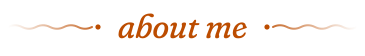
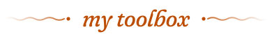
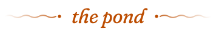

  <picture>
    <source media="(prefers-color-scheme: dark)" srcset="assets/tagline-dark.svg" />
    <source media="(prefers-color-scheme: light)" srcset="assets/tagline-light.svg" />
    
  </picture>

  
   
  <i>this koi is drawn from my GitHub activity and redrawn every night — it grows when I commit</i>

 

  <picture>
    <source media="(prefers-color-scheme: dark)" srcset="assets/h-about-dark.svg" />
    <source media="(prefers-color-scheme: light)" srcset="assets/h-about-light.svg" />
    
  </picture>

  🔭 currently working on <b>Strata / VEX</b> with team <b>2982Z</b> 
  🌱 currently learning <b>Rust</b> 
  🍕 fun fact: i love pizza

 

  <picture>
    <source media="(prefers-color-scheme: dark)" srcset="assets/h-tools-dark.svg" />
    <source media="(prefers-color-scheme: light)" srcset="assets/h-tools-light.svg" />
    
  </picture>

  

 

  <picture>
    <source media="(prefers-color-scheme: dark)" srcset="assets/h-pond-dark.svg" />
    <source media="(prefers-color-scheme: light)" srcset="assets/h-pond-light.svg" />
    
  </picture>

  <picture>
    <source media="(prefers-color-scheme: dark)" srcset="pond/snake-dark.svg" />
    <source media="(prefers-color-scheme: light)" srcset="pond/snake-light.svg" />
    
  </picture>
   
  <i>a hungry koi eating its way through my contribution graph, refreshed daily</i>

<picture>
  <source media="(prefers-color-scheme: dark)" srcset="assets/footer-dark.svg" />
  <source media="(prefers-color-scheme: light)" srcset="assets/footer-light.svg" />
  
</picture>
