  

  

 

  

 

  <picture>
    <source media="(prefers-color-scheme: dark)" srcset="pond/snake-dark.svg" />
    <source media="(prefers-color-scheme: light)" srcset="pond/snake-light.svg" />
    
  </picture>

<picture>
  <source media="(prefers-color-scheme: dark)" srcset="assets/footer-dark.89e693b5.svg" />
  <source media="(prefers-color-scheme: light)" srcset="assets/footer-light.90379e26.svg" />
  
</picture>
