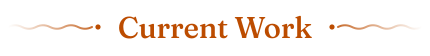
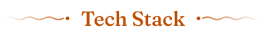
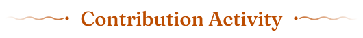

  <picture>
    <source media="(prefers-color-scheme: dark)" srcset="assets/tagline-dark.svg" />
    <source media="(prefers-color-scheme: light)" srcset="assets/tagline-light.svg" />
    
  </picture>

  

  <picture>
    <source media="(prefers-color-scheme: dark)" srcset="assets/h-work-dark.svg" />
    <source media="(prefers-color-scheme: light)" srcset="assets/h-work-light.svg" />
    
  </picture>

  

 

  <picture>
    <source media="(prefers-color-scheme: dark)" srcset="assets/h-stack-dark.svg" />
    <source media="(prefers-color-scheme: light)" srcset="assets/h-stack-light.svg" />
    
  </picture>

  

 

  <picture>
    <source media="(prefers-color-scheme: dark)" srcset="assets/h-activity-dark.svg" />
    <source media="(prefers-color-scheme: light)" srcset="assets/h-activity-light.svg" />
    
  </picture>

  <picture>
    <source media="(prefers-color-scheme: dark)" srcset="pond/snake-dark.svg" />
    <source media="(prefers-color-scheme: light)" srcset="pond/snake-light.svg" />
    
  </picture>

<picture>
  <source media="(prefers-color-scheme: dark)" srcset="assets/footer-dark.svg" />
  <source media="(prefers-color-scheme: light)" srcset="assets/footer-light.svg" />
  
</picture>
